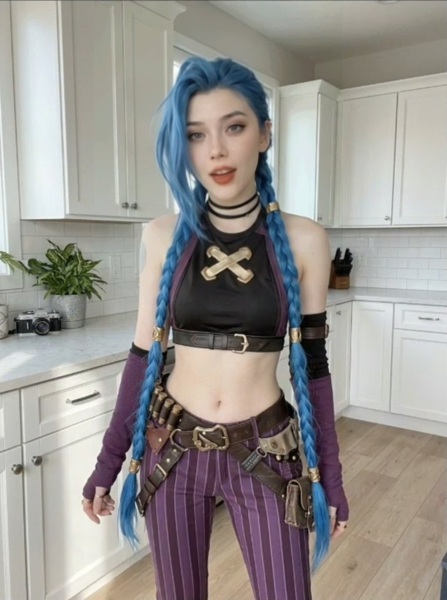
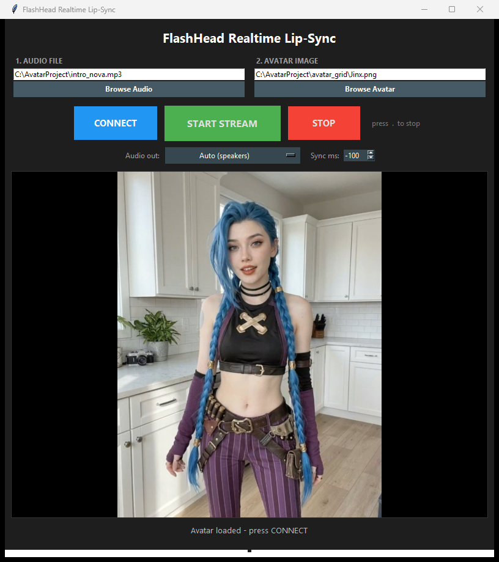

<div align="center">

# FlashHead Realtime Lip-Sync

**One portrait PNG in. A live talking avatar out — lips locked to the audio, in its own window.**


[Quick start](#quick-start) · [How it works](#how-it-works) · [Setup](#setup-from-scratch) · [Troubleshooting](#troubleshooting) · [Credits](#credits)

</div>



*A frame from the live view. Only the head box is animated — the body, hands and
background are the original pixels, untouched.*

---

## What it is

A small desktop app that drives the **FlashHead** talking-head server:

1. pick an audio file and an avatar image,
2. **CONNECT** loads the avatar,
3. **START STREAM** and the avatar talks — live, in the app window, with the
   same audio playing in sync.

It is a **client**. The heavy lifting — the model, the streaming protocol, the
presets — belongs to Chris's [sapphire-flashhead](https://github.com/ddxfish/sapphire-flashhead)
plugin, which this app runs **unchanged** over HTTP on `127.0.0.1:5017`.

**Sapphire is not required.** FlashHead started as a Sapphire plugin, but its
server runs standalone and that is exactly how this app uses it.

| | |
| --- | --- |
| **In** | any audio file + a portrait PNG/JPG/WebP |
| **Out** | a live talking avatar in a window, audio in sync |
| **Needs** | an NVIDIA GPU with ~6 GB free VRAM, ~13 GB disk |
| **Not needed** | Sapphire, a cloud service, an API key, a Python install by hand |

---

## Quick start

```bat
git clone https://github.com/MovLab2/flashhead-lipsync
cd flashhead-lipsync
SETUP FlashHead (once).bat
START Lip-Sync App.bat
```

Then: **Browse Audio** → **Browse Avatar** → **CONNECT** → **START STREAM**.
Press **`.`** to stop.

<details>
<summary><b>What the two scripts do, and how long they take</b></summary>

| step | what happens | time |
| --- | --- | --- |
| `SETUP FlashHead (once).bat` | clones the FlashHead plugin into `flashhead\`, makes the `flashhead-server` conda env (Python 3.10), installs the server packages (~5 GB) and this app's packages | 10–30 min |
| first **CONNECT** | starts the server, downloads the engine + weights (~8 GB) into `flashhead\user\models\flashhead`, loads them onto the GPU | download + ~1 min |
| later **CONNECT**s | weights load from disk into VRAM | ~45–60 s |
| **START STREAM** | renders and plays at ~1.5x realtime on an RTX 5060 Ti | instant |

Both scripts are safe to re-run; they only fill in what is missing. The setup
reuses an existing `flashhead-server` or `sapphire-plugin-flashhead`
environment instead of building a second one.

</details>

---

## Credits

This app is a thin client on top of other people's work. None of it would exist
without them:

- **[Chris (ddxfish)](https://github.com/ddxfish)** — [Sapphire](https://github.com/ddxfish/sapphire)
  and the **[sapphire-flashhead](https://github.com/ddxfish/sapphire-flashhead)**
  plugin: the server, the streaming protocol, the memory presets, the model
  fetching, the face/mood handling and the panel. This project **runs that
  server unchanged** and modifies none of it.
- **[Teri (MovLab2)](https://github.com/MovLab2)** — the original streaming
  approach (`teri-realtime-avatar-5060ti`) that the plugin's README credits, and
  this desktop app.
- **[Soul-AILab](https://github.com/Soul-AILab)** — **SoulX-FlashHead**, the
  audio-driven talking-head model (Apache-2.0).
- **Lightricks** — the **LTX-Video 0.9 VAE** the Lite model uses
  (**OpenRAIL-M**, with use restrictions — see [Licenses](#what-gets-downloaded-and-its-licenses)).

The plugin's own code is MIT. This app's code is MIT too (see `LICENSE`) — that
covers this repository's files only; the plugin and the models keep their own
licences, listed under [Licenses](#what-gets-downloaded-and-its-licenses).

---

## How it works

```
+--------------+        +---------------------------+        +-----------------+
| audio file   | -----> |  FlashHead HTTP server    | -----> | JPEG frames +   |
| (any format) |  POST  |  standalone, port 5017    |  GET   | the same audio  |
+--------------+ /speak +---------------------------+ /stream+-----------------+
                                                                |
      +---------------------------------------------------------+
      |
      v
  decode frame -> paste into the avatar's head box -> show in the window
  audio plays from the device clock, frames follow that clock
```

Three decisions make it look right:

- **The video clock is the audio device's playback position**, not a wall clock.
  Frames are *dropped* when the GPU falls behind, never fast-forwarded, so the
  lips cannot drift from the voice over a long clip.
- **Only the head box is rendered.** The server draws a 512×512 head; the app
  pastes it back into the original portrait with a feathered seam. The body,
  hands and background stay pixel-perfect, and the face is never squashed.
- **The offset is measured, not guessed.** A probe clip gives the model's own
  mouth latency; `Sync ms` cancels it (default `-100` ms on an RTX 5060 Ti).

---

## Requirements

| | |
| --- | --- |
| GPU | NVIDIA, compute capability **8.0+**, driver **570 or newer** (CUDA 12.8) |
| VRAM | **~6 GB** free (Full) · ~4 GB (Lean) · ~3 GB (Smallest) |
| Disk | **~13 GB**: the Python env (~5 GB) + the models (~8 GB) |
| OS | Windows or Linux (CPU, AMD/ROCm and macOS are not supported) |
| conda | Miniconda or Anaconda |
| git | only to fetch the plugin (a ZIP works too) |

This app's own packages (the setup script installs them):

```
opencv-python  numpy  PyYAML  tqdm  soundfile  resampy  sounddevice  pillow
```

`sounddevice` gives sample-accurate playback and the clock the video follows.
`ffmpeg` on `PATH` is only needed for the optional batch MP4 pipeline.

---

## Setup from scratch

### 1. Get the plugin

The setup script clones it for you. To do it by hand:

```bat
git clone https://github.com/ddxfish/sapphire-flashhead
```

The app looks in all of these, so any of them works:

```
<this app folder>\flashhead\
<this app folder>\sapphire-flashhead\
<the folder holding this app>\sapphire-flashhead\
%USERPROFILE%\sapphire-flashhead\
%USERPROFILE%\sapphire\
```

Or point at it with a one-line `flashhead_root.txt` beside `realtime_app.py`:

```
D:\AI\sapphire-flashhead
```

### 2. Run the setup (once)

Double-click **`SETUP FlashHead (once).bat`**. It finds or clones the plugin,
finds conda, creates the **`flashhead-server`** environment (Python 3.10),
installs the server packages listed in the plugin's own `plugin.json`
(torch 2.7.1+cu128, torchvision, triton-windows, transformers 4.57.3,
diffusers 0.39.0, accelerate, einops, pyloudnorm, loguru, pyyaml, pillow, av,
huggingface_hub, cryptography), then this app's packages.

### 3. Let it fetch the models

Start the server once — the app does this on the first **CONNECT**, or run the
plugin's own launcher in an Anaconda Prompt:

```bat
cd /d C:\path\to\sapphire-flashhead
flashhead-server.bat
```

On first start it fetches, by itself:

| what | from | lands in | size |
| --- | --- | --- | --- |
| engine code, pinned `9bc03de06bb0` | `Soul-AILab/SoulX-FlashHead` | `user\models\flashhead\engine\9bc03de06bb0` | ~0.4 GB |
| Lite DiT weights (`Model_Lite`) | `Soul-AILab/SoulX-FlashHead-1_3B` | `user\models\flashhead\SoulX-FlashHead-1_3B\Model_Lite` | ~5.7 GB |
| LTX-Video VAE (`VAE_LTX`) | `Soul-AILab/SoulX-FlashHead-1_3B` | `user\models\flashhead\SoulX-FlashHead-1_3B\VAE_LTX` | ~1.6 GB |
| audio encoder | `facebook/wav2vec2-base-960h` | `user\models\flashhead\wav2vec2-base-960h` | ~0.4 GB |

Progress shows in the server window and on `/health`
(`"status": "downloading the Lite model 3.4 / 7.2 GB"`). A stopped download
resumes where it left off. The app keeps waiting while the download moves, so a
slow line is not treated as a hang.

Everything lands in `user\` **beside the plugin**, never in the plugin's own
files (its signature would refuse that):

```
sapphire-flashhead\
└── user\
    ├── models\flashhead\          <- engine + weights + cache (~8 GB)
    │   ├── SoulX-FlashHead-1_3B\
    │   ├── wav2vec2-base-960h\
    │   ├── engine\9bc03de06bb0\
    │   ├── faces\                 <- faces other computers sent
    │   └── cache\                 <- torch.compile kernels
    ├── webui\plugins\flashhead.json   <- preset / video-memory setting
    ├── flashhead\measured.json        <- measured speed per preset
    └── worker_door\flashhead\         <- only if you share the server
```

### 4. Verify

These four must exist before the app can work:

```
sapphire-flashhead\user\models\flashhead\engine\9bc03de06bb0\
sapphire-flashhead\user\models\flashhead\SoulX-FlashHead-1_3B\Model_Lite\diffusion_pytorch_model.safetensors
sapphire-flashhead\user\models\flashhead\SoulX-FlashHead-1_3B\VAE_LTX\diffusion_pytorch_model.safetensors
sapphire-flashhead\user\models\flashhead\wav2vec2-base-960h\model.safetensors
```

And the service answers:

```bash
curl http://127.0.0.1:5017/health
```

You want `"status": "ready"` (and `"face": false` until an avatar is loaded).

### 5. Run the app

```bat
START Lip-Sync App.bat
```

The launcher picks the `flashhead-server` environment (or
`sapphire-plugin-flashhead`, if that is what you have) and starts
`realtime_app.py` with it. **Use that Python** — the app starts `server.py` with
the same interpreter, so app and server must share one environment.

If the app cannot find the plugin, CONNECT says so and repeats these steps.

### Already running Sapphire?

If Sapphire is installed with the FlashHead plugin enabled, skip steps 1–2: the
app finds `<sapphire>\user\plugins\flashhead\server.py` by itself, and the models
are already in `<sapphire>\user\models\flashhead`. Nothing is written into
Sapphire.

---

## Using the app

1. **Browse Audio** — `.mp3 .wav .ogg .flac .m4a`.
2. **Browse Avatar** — a portrait `.png .jpg .webp`. The preview shows the whole image.
3. **CONNECT** — sends the head crop to the server. If port 5017 is closed it
   starts the server first (~45 s once the models are on disk).
4. **START STREAM** — the avatar talks live.
   - `Audio out` — pick the device you actually hear (see Troubleshooting).
   - `Sync ms` — nudge the lips: negative = earlier, positive = later. Default `-100`.
5. **`.`** or **STOP** ends it. The window stays open and shows the frame count.



*The window: two pickers, CONNECT / START STREAM / STOP, the output device, and
the sync nudge. The preview always shows the whole image — never a crop.*

---

## Head boxes

The server renders a square (512×512) talking head. Send it a full portrait
(1111×1490) and it is squashed into that square — the face warps. So the app:

1. looks up the avatar's head box in `head_boxes.csv`,
2. otherwise detects it (chest to above the head) with OpenCV,
3. sends only that crop to the server,
4. pastes the animated result back into the original image at the same box.

Boxes are cached per filename:

```csv
image,x,y,w,h
jinx.png,234,0,618,759
```

Delete a row to force re-detection, or add a row to pin an avatar by hand.
Detection is a best effort: side profiles and stylised art can miss, so pin
those by hand.

---

## Server and API

The plugin's own launcher is the supported way to run it by hand:

```bat
cd /d C:\path\to\sapphire-flashhead
flashhead-server.bat
```

The bare command behind it:

```bat
set SAPPHIRE_ROOT=C:\path\to\sapphire-flashhead
set SAPPHIRE_SERVICE_PORT=5017
set PYTHONUTF8=1
cd /d "%SAPPHIRE_ROOT%"
"C:\Users\<you>\miniconda3\envs\flashhead-server\python.exe" server.py
```

`SAPPHIRE_ROOT` is the plugin's folder in standalone mode, or the Sapphire
folder when the plugin sits at `<root>\user\plugins\flashhead`. Without it the
server stops with `KeyError: 'SAPPHIRE_ROOT'`.

The app starts the server with exactly those variables. It does **not** enable
the plugin launcher's optional sharing door (port 5018), so nothing is exposed
beyond `127.0.0.1:5017`.

| endpoint | purpose |
| --- | --- |
| `GET /health` | status, preset, speed, viewer count |
| `POST /face` | load the avatar (raw image body, `X-FlashHead: 1`) |
| `POST /speak` | submit audio (raw body) |
| `GET /stream?audio=1` | packet stream: `>I header_len \| JSON header \| audio \| JPEGs` |

Packets with `kind: "idle"` are filler and are ignored; only `kind: "speech"`
frames are shown, and the audio clock starts on the first speech frame.

---

## Presets (Settings › FlashHead › Video memory)

| preset | render size | weights | VRAM | speed (RTX 5060 Ti, measured) |
| --- | --- | --- | --- | --- |
| `full` | 512 px | 16-bit | ~6 GB | ~1.4–1.5x realtime |
| `lean` | 384 px | 8-bit | ~4 GB | ~2.4x realtime |
| `smallest` | 384 px | 4-bit | ~3 GB | fastest, softest |

In standalone mode the setting lives in
`<plugin>\user\webui\plugins\flashhead.json`. Switching presets shrinks the same
weights on the CPU as they load — nothing downloads again. On Windows, a card
that runs out of VRAM pages to system RAM silently and the face crawls at a
tenth of real time; a leaner preset fixes it.

---

## Lip-sync: how it is measured

Guessing is not allowed, so the offset is measured with a probe:

```
python make_probe.py      # 8 short speech bursts separated by silence
python verify_probe.py    # plays the probe, tracks the mouth, reports the offset
```

The mouth must open on every burst, so the mouth-motion curve can be aligned
against the burst schedule. On this machine the model's mouth landed ~120 ms
after the sound; `Sync ms = -100` (the default) moves it back to 0–40 ms.

Other checks:

```
python test_parser.py     # packet parser, including partial packets
python e2e_test.py        # connect -> stream -> screenshot
python verify_sync.py     # mouth motion over a full clip
python list_devices.py    # audio outputs, to pick the right one
```

---

## Troubleshooting

| symptom | cause | fix |
| --- | --- | --- |
| `FlashHead server not found` | plugin not where the app looked | run `SETUP FlashHead (once).bat`, or write the folder into `flashhead_root.txt` |
| Window opens, CONNECT fails instantly | server not running and won't start | run `flashhead-server.bat` in an Anaconda Prompt and read its window |
| `KeyError: 'SAPPHIRE_ROOT'` | server started without the env var | set `SAPPHIRE_ROOT`, or launch through the app |
| `ModuleNotFoundError: sounddevice` | the app was started with a different Python than the server's env | use `START Lip-Sync App.bat`, or `pip install -r requirements.txt` in that env |
| CONNECT sits on `downloading ...` | first run, models are ~8 GB | let it finish; progress is in GB on `/health` and in the status line |
| Models download again after moving the plugin | the data folder follows the plugin (`user\` beside it) | move the whole folder, or set `models_dir` in the FlashHead settings |
| **No sound**, but the mouth moves | Windows' default output is a virtual cable (VB-Audio) | pick the real speakers in **Audio out** |
| Sound plays, no frames | another viewer holds the stream, or the model is still loading | wait for `"status": "ready"`, then START STREAM again |
| Lips drift or look late | GPU slower than real time | use the **Lean** preset; frames are skipped, never fast-forwarded |
| Face looks stretched | a whole portrait was sent instead of the head box | delete that avatar's row in `head_boxes.csv` and reconnect |
| Detection misses the head | side profile / stylised art | add a row to `head_boxes.csv` by hand |
| Everything crawls at ~1/10 speed | VRAM exhausted, Windows paged to system RAM | Lean/Smallest preset |
| First CONNECT takes ~45 s | weights loading into VRAM | expected; later connects are instant |
| `port 5017 already in use` | another FlashHead server is running | close it, or let the app reuse it (it checks `/health` first) |

---

## Files

| file | role |
| --- | --- |
| `realtime_app.py` | the GUI: pickers, connect, live view, audio clock, packet parsing |
| `flashhead_inference.py` | `FlashHeadClient` — health / wait / set_face / speak |
| `face_detector.py` | head box detection (chest to above head) |
| `compositor.py` | paste the animated head back with a feathered seam |
| `head_boxes.csv` | remembered head boxes, one row per avatar filename |
| `pipeline.py` | batch pipeline: audio + avatar → MP4 |
| `muxer.py` | frames + audio → MP4 (ffmpeg) |
| `trim.py` | trims idle frames at the end of a render |
| `test_existing.py` | CLI for the batch pipeline |
| `SETUP FlashHead (once).bat` | fetches the plugin, builds the env, installs packages |
| `START Lip-Sync App.bat` | launcher |

### Batch (offline) rendering

```
python test_existing.py --audio in.mp3 --avatar avatar.png --out out.mp4
```

---

## What gets downloaded and its licenses

Nothing below is in this repository or in the plugin's repository; each comes
from its source the first time it is needed.

| what | from | license |
| --- | --- | --- |
| engine `flash_head/` at `9bc03de0` | github.com/Soul-AILab/SoulX-FlashHead | Apache-2.0 |
| FlashHead 1.3B Lite DiT weights | huggingface.co/Soul-AILab/SoulX-FlashHead-1_3B | Apache-2.0 |
| LTX-Video 0.9 VAE (`VAE_LTX`) | same repo | **OpenRAIL-M** — its Attachment A use restrictions bind everyone running Lite, including **no impersonating a real person without their consent** |
| wav2vec2-base-960h | huggingface.co/facebook/wav2vec2-base-960h | Apache-2.0 |
| Python env (transformers, diffusers, accelerate, einops, pyloudnorm, loguru, pyyaml, pillow, huggingface_hub, cryptography, …) | PyPI | Apache-2.0 / MIT / BSD / MIT-CMU |
| torch, torchvision (cu128) | download.pytorch.org | BSD-3 (+ NVIDIA CUDA runtime wheels) |
| av | PyPI | BSD-3; its wheels bundle a GPL build of FFmpeg |
| triton-windows (Windows only) | PyPI | MIT |

**Use your own face, or one you have permission to use.** The VAE licence above
forbids impersonating a real person without their consent.

---

## Notes and limits

- The server renders at roughly real time on a single RTX 5060 Ti (Full preset).
  If the GPU falls behind, frames are **skipped, never fast-forwarded**, so the
  lips stay on the voice.
- Audio is resampled to 16 kHz mono for the server; playback uses the device's
  own sample rate.
- Windows' default output device is often a virtual cable (VB-Audio). The app
  picks real speakers automatically; use the `Audio out` menu if you hear nothing.
- The head box is detected once per avatar and cached.
- Model weights are **not** in this repository — they are ~8 GB and rebuild
  from Hugging Face on demand.
